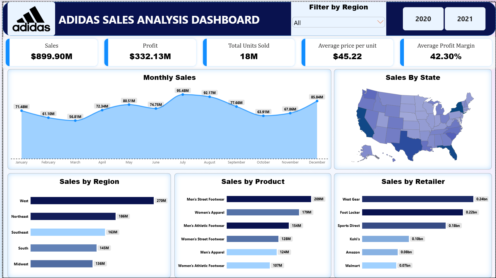

# Adidas Sales Analysis Dashboard | Power BI

An interactive sales analytics dashboard developed as an independent portfolio project to explore sales performance, product categories, regional trends, sales channels, and retailer contributions.

## Project Overview

This project focuses on transforming sales data into an interactive dashboard that supports business performance analysis and data-driven decision-making.

## Objectives

- Analyze monthly sales trends.
- Compare sales performance across regions.
- Explore sales distribution across US states.
- Identify leading product categories.
- Compare retailer sales performance.
- Evaluate key sales and profitability metrics.

## Tools & Technologies

- Microsoft Power BI
- DAX (Data Analysis Expressions)
- Power Query
- Data visualization and business intelligence

## Dashboard Features

### Key Performance Indicators
- Total Sales: $899.90M
- Total Profit: $332.13M
- Total Units Sold: 18M
- Average Price per Unit: $45.22
- Average Profit Margin: 42.30%

### Visualizations
1. Monthly Sales Trend
2. Sales by US State
3. Sales by Region
4. Sales by Product Category
5. Sales by Retailer

### Interactive Filters
- Region filter
- Year selection: 2020 and 2021

## Initial Observations

- July has the highest displayed monthly sales at $95.48M.
- March has the lowest displayed monthly sales at $56.81M.
- The West is the leading region in the displayed regional comparison at approximately $270M.
- Men's Street Footwear leads the displayed product categories at approximately $209M.
- West Gear leads the displayed retailer comparison at approximately $0.24B.

## Files

- `images/adidas.png` — Dashboard screenshot
- `Adidas_Sales_Analysis.pbix` — Power BI report file

## How to Explore

1. View the dashboard screenshot in this repository.
2. If the `.pbix` file is included, open it using Microsoft Power BI Desktop.
3. Interact with the year and region filters to explore the report.

## Disclaimer

This is an independent portfolio project created for educational and analytical demonstration purposes. It is not an official Adidas project and is not affiliated with or endorsed by Adidas. Any trademarks and logos belong to their respective owners.
